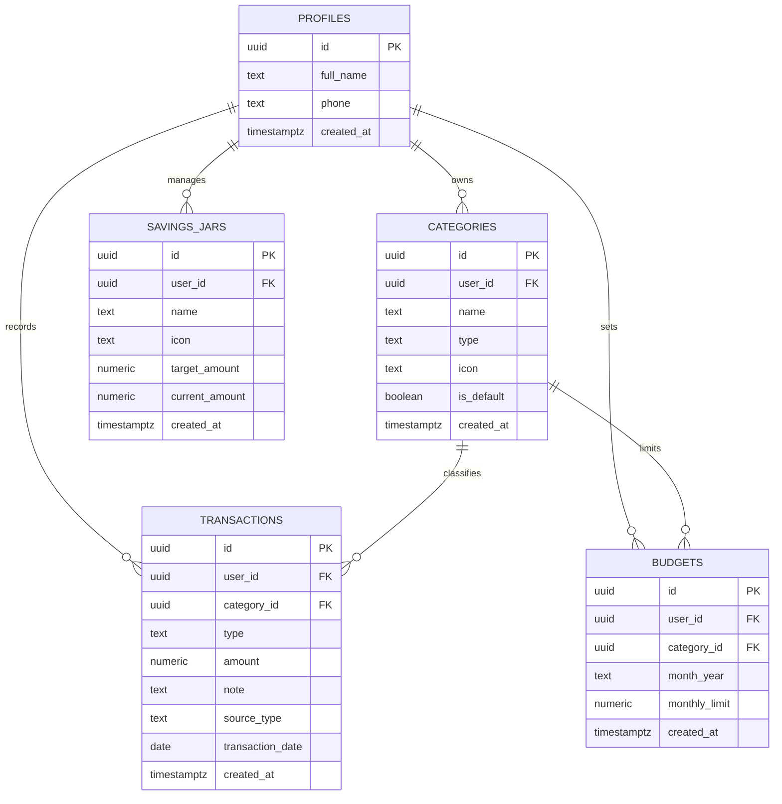
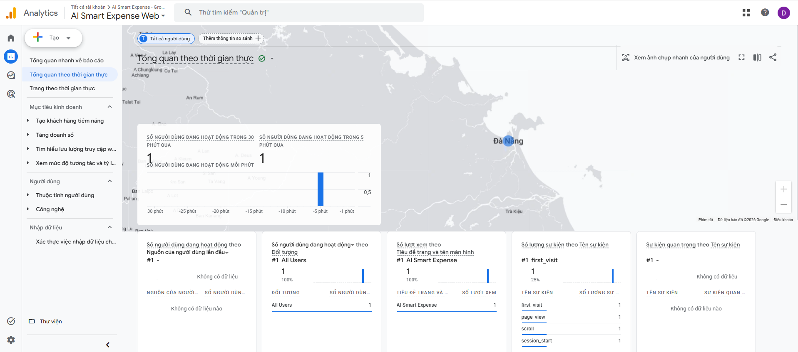
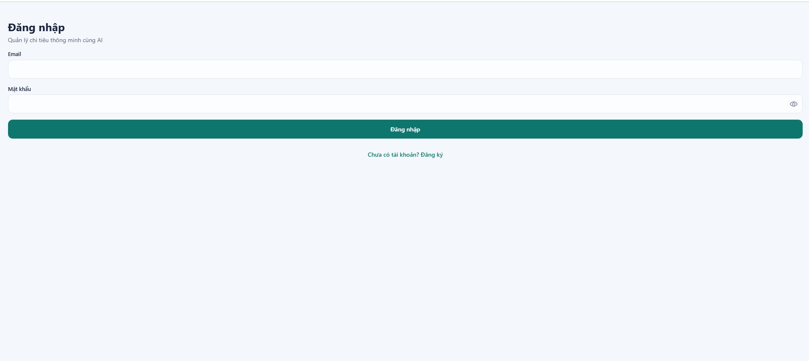
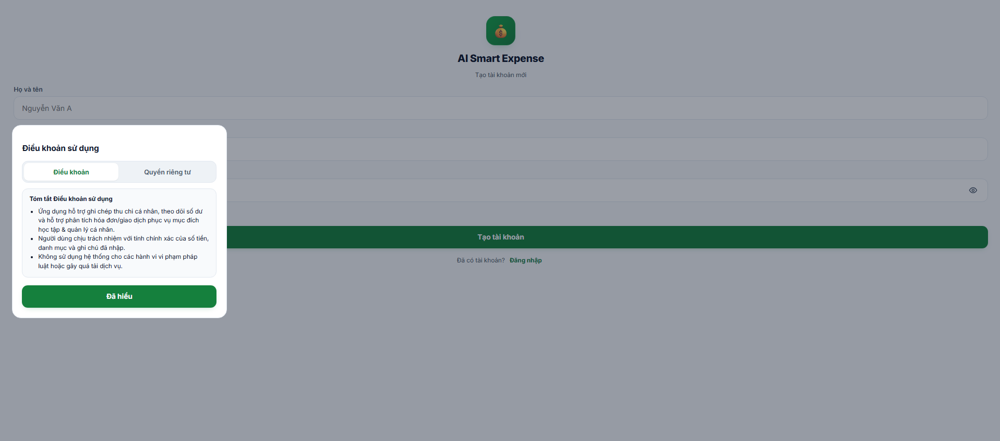
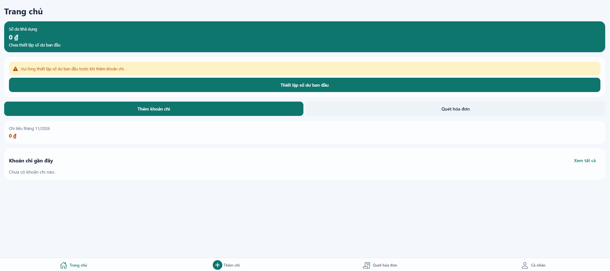
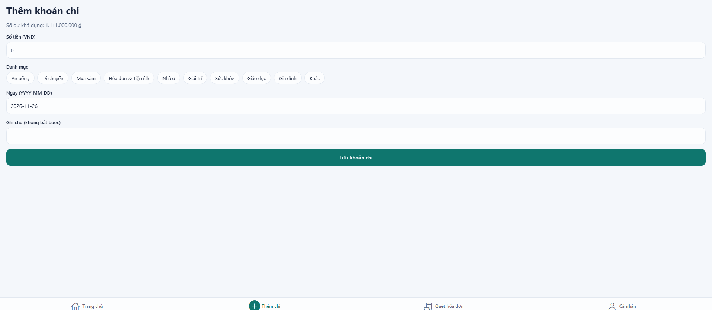
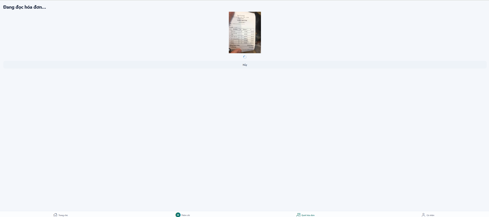
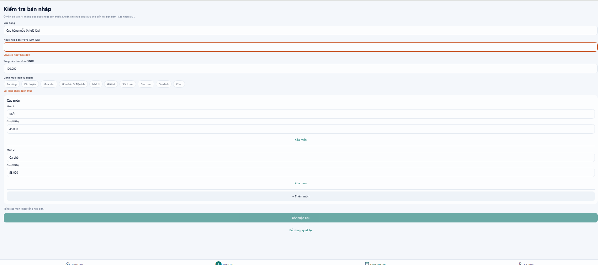
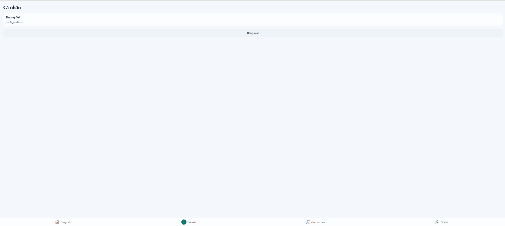

# Quản Lý Chi Tiêu — AI Smart Expense (Nhóm 6)

Ứng dụng quản lý chi tiêu cá nhân: thiết lập số dư ban đầu, thêm khoản thu/chi thủ công, **quét hóa đơn bằng AI** (AI tạo bản nháp, người dùng sửa rồi mới lưu), xem lịch sử giao dịch. Frontend chỉ gọi backend; backend giữ API key và gọi AI.

**Môn học:** Web Design and Development (CSB25022) — VNUK
- **Web ứng dụng:** https://quan-ly-chi-tieu-sooty.vercel.app/
- **Kho mã nguồn:** https://github.com/tonthatduongdat2006/quan-ly-chi-tieu

> **Trạng thái dữ liệu:** ứng dụng hiện lưu tài khoản và giao dịch trong `localStorage` của trình duyệt. Thiết kế CSDL PostgreSQL ở mục *Thiết kế cơ sở dữ liệu* bên dưới **chưa được kết nối** với ứng dụng.

## Các trang (mỗi trang có URL riêng)

| URL | Nội dung | Giao diện |
|---|---|---|
| [`/index.html`](https://quan-ly-chi-tieu-sooty.vercel.app/index.html) (trang chủ `/`) | Đăng nhập/đăng ký, Trang chủ (số dư), Thêm khoản chi/thu, Quét hóa đơn AI, Cá nhân | CSS tự viết + Tailwind cho khung bố cục (căn giữa trên màn hình ≥1024px) và các liên kết điều hướng |
| [`/history.html`](https://quan-ly-chi-tieu-sooty.vercel.app/history.html) | Lịch sử giao dịch của tài khoản đang đăng nhập; lọc theo loại, tìm theo danh mục/ghi chú; tổng thu, tổng chi | Tailwind |
| [`/about.html`](https://quan-ly-chi-tieu-sooty.vercel.app/about.html) | Giới thiệu dự án | Tailwind |
| [`/contact.html`](https://quan-ly-chi-tieu-sooty.vercel.app/contact.html) | Liên hệ: gửi góp ý/báo lỗi qua GitHub Issues, thông tin nhóm | Tailwind |

Các trang con có thanh điều hướng chung (Trang chủ · Lịch sử · Giới thiệu · Liên hệ). Từ trang chủ, mở màn **Cá nhân** để tới Lịch sử chi tiết, Giới thiệu, Liên hệ.

## Công nghệ & cấu trúc thư mục

- **Giao diện:** HTML, React 18 (bản UMD, không cần build) + `htm` trong `public/index.html`; JavaScript thuần trong `history.html`.
- **Tailwind CSS v4** cài qua npm (`tailwindcss`, `@tailwindcss/cli`), biên dịch sẵn thành file CSS tĩnh — không dùng CDN.
- **Backend:** Node.js thuần (`server.js`, không thư viện ngoài) — phục vụ `public/` và API AI.
- **Theo dõi:** Google Analytics 4.

```text
public/
  index.html            Ứng dụng chính (React UMD)
  history.html          Lịch sử giao dịch
  about.html            Giới thiệu
  contact.html          Liên hệ
  css/tailwind.css      Tailwind đã biên dịch (đầy đủ) cho history/about/contact
  css/tailwind-app.css  Tailwind không có preflight cho index.html (không làm đổi CSS sẵn có)
src/styles/             File nguồn Tailwind (đầu vào của npm run build:css)
server.js               Backend: phục vụ public/ + API AI
test/api.test.js        Kiểm thử backend (npm test)
db/schema.sql           Bản thiết kế lược đồ PostgreSQL (chưa kết nối ứng dụng)
doc/                    Tài liệu, ảnh minh chứng
```

## Chạy thử trên máy

Cần Node.js **18 trở lên**.

```bash
git clone https://github.com/tonthatduongdat2006/quan-ly-chi-tieu.git
cd quan-ly-chi-tieu
npm install          # cài Tailwind CSS (devDependencies)
npm run build:css    # biên dịch src/styles/*.css -> public/css/*.css (cần chạy lại khi thêm class Tailwind mới)
cp .env.example .env # điền AI_API_KEY (và AI_PROVIDER nếu không dùng anthropic)
npm start            # mở http://localhost:3000
npm test             # chạy kiểm thử backend
```

Không có `AI_API_KEY` thì các trang vẫn chạy; riêng nút **Phân tích AI** sẽ báo "Tính năng AI chưa được cấu hình".

## API

Mọi lỗi đều có dạng `{ "error": { "code": "...", "message": "..." } }` kèm mã HTTP tương ứng.

| Endpoint | Gửi lên | Trả về |
|---|---|---|
| `GET /api/health` | — | `{ ok, ai: { configured } }` |
| `POST /api/ai/parse-text` (backend có sẵn, giao diện hiện chưa có màn hình gọi endpoint này) | JSON `{ text, ctx }` | `{ items: [{ type, amount, cat, note, date }], reply }` |
| `POST /api/ai/parse-receipt` | JSON `{ image, mimeType, ctx }` (`image` = base64) | `{ readable, merchant, type, amount, cat, note, date }` |

`ctx` = `{ today: "YYYY-MM-DD", cats: { expense: [...], income: [...] } }`: ngày hôm nay theo múi giờ người dùng và danh sách danh mục hiện có.

Quy ước dữ liệu: `type` là `expense` hoặc `income`; `amount` là số nguyên VND, **`null` nếu AI không thấy số tiền** (không đoán); `cat` luôn nằm trong danh mục của người dùng, nếu không khớp thì `Khác`; `date` là `null` nếu không đọc được hoặc là ngày tương lai (giao diện sẽ cảnh báo).

| Mã lỗi | HTTP | Ý nghĩa |
|---|---|---|
| `ai_not_configured` | 503 | Backend chưa có `AI_API_KEY` |
| `ai_auth` | 503 | API key sai hoặc không có quyền |
| `ai_quota` | 503 | Hết hạn mức / hết tiền trên tài khoản AI |
| `ai_rate_limited` | 429 | Dịch vụ AI đang giới hạn tần suất |
| `ai_timeout` / `ai_unavailable` | 504 / 502 | AI không phản hồi / gián đoạn |
| `ai_invalid_output` | 502 | AI trả dữ liệu sai cấu trúc |
| `receipt_unreadable` | 422 | Không đọc được tổng tiền trên hóa đơn |
| `bad_image` / `payload_too_large` | 415 / 413 | Ảnh không hợp lệ / quá 5MB |
| `rate_limited` / `daily_limit` | 429 | Vượt giới hạn của backend (theo IP / theo ngày) |
| `origin_not_allowed` | 403 | Website chưa nằm trong `ALLOWED_ORIGINS` |

Khi AI lỗi, backend **trả lỗi, không bao giờ tạo kết quả thay thế**.

## Biến môi trường

Xem chi tiết và giá trị mặc định trong [`.env.example`](.env.example). Quan trọng nhất:

- `AI_PROVIDER`: `anthropic` (mặc định) hoặc `openai` (OpenAI hoặc dịch vụ tương thích, đặt thêm `AI_BASE_URL`).
- `AI_API_KEY`: khóa API, **chỉ đặt ở backend**.
- `AI_MODEL_TEXT` / `AI_MODEL_VISION`: model cho tin nhắn / cho ảnh hóa đơn. Mặc định dùng model nhỏ, rẻ cho tin nhắn và model mạnh hơn cho ảnh. Hãy kiểm tra tên model còn hiệu lực trong tài khoản của bạn.
- `ALLOWED_ORIGINS`, `RATE_LIMIT_PER_MIN`, `DAILY_REQUEST_LIMIT`, `TRUST_PROXY_HOPS`: bảo vệ chi phí, xem phần Bảo mật.

## Triển khai lên Internet

### Cách A — một dịch vụ duy nhất (khuyến nghị, đơn giản nhất)

Backend phục vụ luôn giao diện trong `public/`, cùng domain nên không cần cấu hình CORS.

1. Đẩy thư mục này lên Git (đã có `.gitignore` chặn `.env`).
2. Tạo Web Service trên hosting chạy Node (Render, Railway, Fly.io, VPS…). Lệnh khởi động: `node server.js`. Hoặc dùng `Dockerfile` đi kèm.
3. Trong phần **Environment Variables** của hosting, đặt `AI_API_KEY`, và `TRUST_PROXY_HOPS=1` (hosting thường có 1 lớp proxy).
4. Hosting cấp domain HTTPS, mở domain đó là dùng được.

### Cách B — frontend và backend ở hai nơi

1. Triển khai backend như trên, đặt `SERVE_FRONTEND=false` (tuỳ chọn) và `ALLOWED_ORIGINS=https://ten-mien-frontend.com`.
2. Đưa thư mục `public/` lên hosting tĩnh (ví dụ Vercel).
3. Đặt địa chỉ backend vào thẻ `<meta name="api-base">` trong `public/index.html`.

> Nếu sai `ALLOWED_ORIGINS`, trình duyệt chặn phản hồi nên giao diện chỉ hiện "Không kết nối được máy chủ AI". Mở DevTools → Console để thấy lỗi CORS.

## Bảo mật — cần đọc trước khi công khai

- **API key** chỉ nằm ở biến môi trường backend. Frontend không chứa key, không chứa prompt. Backend không ghi nội dung tin nhắn/ảnh vào log.
- **Đăng nhập của app hiện chỉ lưu trong `localStorage` của trình duyệt**, backend không thể biết ai đang gọi. Vì vậy ai biết địa chỉ backend đều có thể gọi API AI của bạn và tiêu tiền của bạn. Các lớp bảo vệ đã có: giới hạn theo IP, giới hạn tổng theo ngày, danh sách origin, giới hạn kích thước, kiểm tra loại ảnh. Các giới hạn này nằm trong bộ nhớ nên **reset khi server khởi động lại**, và `ALLOWED_ORIGINS` chỉ chặn trình duyệt, không chặn `curl`.
- Vì vậy hãy **đặt hạn mức chi tiêu hằng tháng ngay trên tài khoản nhà cung cấp AI** (đây mới là chốt chặn cuối cùng). Nếu công khai rộng rãi, nên bổ sung tài khoản thật phía server (JWT/session) rồi yêu cầu đăng nhập ở các API `/api/ai/*`.
- Luôn chạy sau HTTPS. Nếu key từng bị lộ, hãy thu hồi và tạo key mới.

## Xử lý sự cố

| Hiện tượng | Nguyên nhân thường gặp |
|---|---|
| "Không kết nối được máy chủ AI" | Backend chưa chạy / sai `api-base` / sai `ALLOWED_ORIGINS` (xem Console). Hosting gói miễn phí có thể đang "ngủ", đợi ~1 phút rồi chạm vào thông báo để thử lại. |
| "Tính năng AI chưa được cấu hình" | Chưa đặt `AI_API_KEY` trên backend. |
| "Máy chủ AI đang gặp lỗi cấu hình" | API key sai/hết hiệu lực (`ai_auth`). Xem log backend. |
| "AI đã hết hạn mức sử dụng" | Hết credit hoặc chạm hạn mức trên tài khoản AI (`ai_quota`). |
| Báo lỗi model không tồn tại (xem log) | Đổi `AI_MODEL_TEXT` / `AI_MODEL_VISION` sang model bạn có quyền dùng. |
| Hóa đơn "không nhận diện được" | Ảnh mờ, bị che hoặc không thấy tổng tiền. Chụp rõ hơn hoặc nhập thủ công. |

Log của backend (stdout) ghi mỗi request một dòng cùng mã lỗi; chi tiết lỗi từ dịch vụ AI chỉ ghi ở log, không trả cho người dùng.

## Thiết kế cơ sở dữ liệu (ERD) — chưa kết nối ứng dụng

> Đây là **bản thiết kế**. Ứng dụng hiện **chưa** đọc/ghi PostgreSQL (dữ liệu đang ở `localStorage`). File `db/schema.sql` hiện có cấu trúc khác với ERD dưới đây và cần được đồng bộ.

Thiết kế trên PostgreSQL (Supabase) gồm 5 bảng (`profiles`, `categories`, `transactions`, `budgets`, `savings_jars`) có khóa ngoại liên kết:

```text
profiles (id [PK -> auth.users.id], full_name, phone, created_at)
  ├── 1:N ──► categories (id [PK], user_id [FK -> profiles.id], name, type, icon, is_default, created_at)
  ├── 1:N ──► transactions (id [PK], user_id [FK -> profiles.id], category_id [FK -> categories.id], type, amount, note, source_type, transaction_date, created_at)
  ├── 1:N ──► budgets (id [PK], user_id [FK -> profiles.id], category_id [FK -> categories.id], month_year, monthly_limit, created_at)
  └── 1:N ──► savings_jars (id [PK], user_id [FK -> profiles.id], name, icon, target_amount, current_amount, created_at)
```



## Kiểm thử

- `npm test`: 11 bài kiểm thử tự động cho backend (chuẩn hóa dữ liệu AI, lỗi dịch vụ AI, giới hạn tần suất, CORS, không lộ API key, chặn đường dẫn ngoài `public/`). Dùng AI giả lập cục bộ nên không tốn phí.
- Kiểm thử thủ công và ảnh responsive 3 kích thước: [doc/TEST_REPORT.md](doc/TEST_REPORT.md), [doc/responsive/](doc/responsive/) (Phạm Minh Phúc).

## Theo dõi, Ghi log

- **Google Analytics 4 (`G-L4X1JXCPK0`):** Đã gắn thẻ `gtag.js` và mở quyền `Content-Security-Policy` trong `server.js` để theo dõi lượt xem trang và người dùng hoạt động theo thời gian thực trên [AI Smart Expense](https://quan-ly-chi-tieu-sooty.vercel.app/).
- **Ghi nhận lỗi & Log hệ thống:** Backend `server.js` ghi log từng request (`method`, `path`, `status`, `latency`, mã lỗi) ra stdout và theo dõi lỗi runtime trên Vercel.

| Minh chứng GA4 Realtime |
| :---: |
|  |

# XỬ LÝ FEEDBACK TỪ CÁC NHÓM KHÁC

| # | Nguồn góp ý (Nhóm / Link Issue) | Nội dung góp ý nhận được | Quyết định | Minh chứng xử lý (Commit / PR) hoặc Lý do không làm |
| :--- | :--- | :--- | :--- | :--- |
| 1 | Nhóm 2 (Peer Review UI/UX) | Hiển thị rõ **Điều khoản sử dụng** và **Chính sách quyền riêng tư** (có thể mở xem chi tiết và bắt buộc đồng ý trước khi tạo tài khoản) | Đồng ý sửa | Đã cập nhật form đăng ký trên `public/index.html` (`https://quan-ly-chi-tieu-sooty.vercel.app/`) thêm checkbox đồng ý và liên kết mở nội dung Điều khoản sử dụng & Chính sách quyền riêng tư; xem ảnh minh chứng tại `README.md` |
| 2 | Nhóm 5 (Peer Review UI/UX) | Tự động đăng nhập và chuyển thẳng vào ứng dụng sau khi đăng ký thành công thay vì bắt đăng nhập lại | Đồng ý sửa | Đã cập nhật luồng xử lý đăng ký trên giao diện để tự lưu phiên và điều hướng thẳng vào trang chủ sau khi tạo tài khoản thành công |

| Giao diện đăng ký | Điều khoản |
| :---: | :---: |
|  |  |

## Demo & Ảnh chụp màn hình (Screenshots)

- **Link triển khai (Live Web):** https://quan-ly-chi-tieu-sooty.vercel.app/
- **Video Demo (YouTube, 720p, ≤ 10 phút):** [Xem video demo trên YouTube](https://youtu.be/Lj0kUyLQhjQ)

### Ảnh chụp màn hình giao diện

| 1. Đăng nhập | 2. Tạo tài khoản |
| :---: | :---: |
|  |  |

| 3. Thiết lập số dư ban đầu | 4. Thêm khoản chi thủ công |
| :---: | :---: |
|  |  |

| 5. Quét hóa đơn AI (1) | 6. Quét hóa đơn AI (2) |
| :---: | :---: |
|  |  |

| 7. Quét hóa đơn AI (3) | 8. Cá nhân & Tài khoản |
| :---: | :---: |
|  |  |
## Thành viên & Đánh giá (Nhóm 6)

| Thành viên | Mã sinh viên | Phụ trách / Vai trò | Đánh giá chung (1 file chung) | Tự đánh giá bản thân |
| :--- | :--- | :--- | :--- | :--- |
| **Tôn Thất Dương Đạt** | `24090061` | Code (cùng AI `claude`): giao diện nhiều trang, Tailwind CSS, backend API AI, cấu hình triển khai, quản lý GitHub, README | [Đánh giá chung nhóm](doc/BANG-TU-DANH-GIA-4-THANH-VIEN.md) | [Tự đánh giá - Tôn Thất Dương Đạt](doc/TU-DANH-GIA-TON-THAT-DUONG-DAT.md) |
| **Văn Lê Tiến Hùng** | `24090008` | Wireframe, Lighthouse, UI/UX Peer Review hai nhóm; định hướng giao diện/luồng thao tác | [Đánh giá chung nhóm](doc/BANG-TU-DANH-GIA-4-THANH-VIEN.md) | [Tự đánh giá - Văn Lê Tiến Hùng](doc/TU-DANH-GIA-VAN-LE-TIEN-HUNG.md) |
| **Phạm Minh Phúc** | `24090011` | Bảng kiểm thử thủ công, ảnh responsive Mobile/Tablet/Desktop, self-report | [Đánh giá chung nhóm](doc/BANG-TU-DANH-GIA-4-THANH-VIEN.md) | *(Chưa cập nhật)* |
| **Nguyễn Hải Đăng** | `24090018` | *(Chưa cập nhật)* | [Đánh giá chung nhóm](doc/BANG-TU-DANH-GIA-4-THANH-VIEN.md) | *(Chưa cập nhật)* |

### Tài liệu bổ sung trong thư mục `doc/`

- [doc/PRD-CHUC-NANG-HE-THONG.md](doc/PRD-CHUC-NANG-HE-THONG.md) — Đặc tả yêu cầu chức năng (PRD) theo mẫu chuẩn.
- [doc/KE-HOACH-VA-PHAN-CONG.md](doc/KE-HOACH-VA-PHAN-CONG.md) — Kế hoạch triển khai theo mốc thời gian, phân công vai trò và quy trình Git.
- [doc/WIREFRAME-KIEN-TRUC-ERD.md](doc/WIREFRAME-KIEN-TRUC-ERD.md) — Thiết kế Wireframe, luồng giao diện, kiến trúc hệ thống và lược đồ CSDL (ERD).
- [doc/TOI-UU-VA-PEER-REVIEW.md](doc/TOI-UU-VA-PEER-REVIEW.md) — Kết quả tối ưu Google Lighthouse, thiết lập logging/tracking và báo cáo UI/UX Peer Review.
- [doc/TU-DANH-GIA-5-SPRINT.md](doc/TU-DANH-GIA-5-SPRINT.md) — Báo cáo tự đánh giá qua 5 sprint (S1–S5).
- [doc/TU-DANH-GIA-TON-THAT-DUONG-DAT.md](doc/TU-DANH-GIA-TON-THAT-DUONG-DAT.md) — Bản tự đánh giá bản thân của Tôn Thất Dương Đạt.
- [doc/TU-DANH-GIA-VAN-LE-TIEN-HUNG.md](doc/TU-DANH-GIA-VAN-LE-TIEN-HUNG.md) — Bản tự đánh giá bản thân của Văn Lê Tiến Hùng.
- [doc/BANG-TU-DANH-GIA-4-THANH-VIEN.md](doc/BANG-TU-DANH-GIA-4-THANH-VIEN.md) — Bảng tự đánh giá bản thân cho 4 thành viên.
