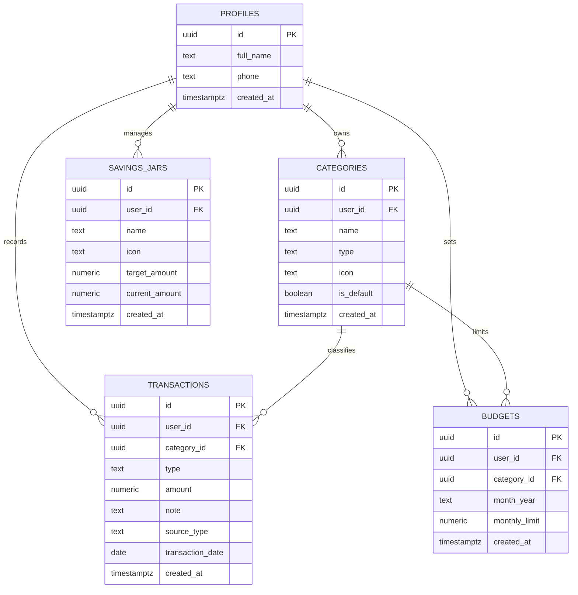
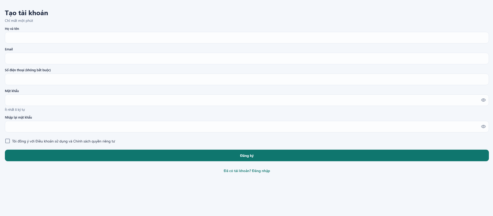
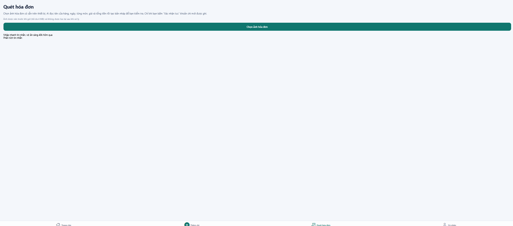

# Quản Lý Chi Tiêu — AI Smart Expense (Group6-QuanLyChiTieu)

Ứng dụng quản lý chi tiêu cá nhân hỗ trợ thiết lập số dư ban đầu, nhập khoản chi thủ công, phân tích tin nhắn nhanh và quét hóa đơn bằng AI. Frontend chỉ gọi backend của bạn; backend giữ API key và gọi AI.
**Môn học:** Web Design and Development (CSB25022) — VN-UK Institute for Research and Executive Education (VNUK)
- **Web ứng dụng:** [AI Smart Expense](https://quan-ly-chi-tieu-sooty.vercel.app/)
- **API / Backend:** [https://quan-ly-chi-tieu-sooty.vercel.app](https://quan-ly-chi-tieu-sooty.vercel.app)
- **Kho mã nguồn (GitHub):** [quan-ly-chi-tieu](https://github.com/tonthatduongdat2006/quan-ly-chi-tieu)

```text
Trình duyệt / Expo Web                        Backend / API                      Dịch vụ AI & CSDL
  Chat: gửi tin nhắn ───────► POST /api/ai/parse-text ──────┐
  Quét: gửi ảnh (base64) ───► POST /api/ai/parse-receipt ───┼─► gọi AI (API key ở biến môi trường)
  ◄── JSON có cấu trúc ◄────── kiểm tra + chuẩn hóa ◄───────┘
  Bản nháp → người dùng sửa → "Xác nhận lưu" → lưu vào PostgreSQL (Supabase): số dư, giao dịch, danh mục, ngân sách, hũ tiết kiệm
```
## Chạy thử trên máy (3 bước)

Cần Node.js **18 trở lên** và Git.

```bash
git clone https://github.com/tonthatduongdat2006/quan-ly-chi-tieu.git
cd quan-ly-chi-tieu
git checkout main
npm install
# Copy .env.example (nếu có) và điền biến môi trường AI / Supabase / API trước khi chạy
```
## API

Mọi lỗi đều có dạng `{ "error": { "code": "...", "message": "..." } }` kèm mã HTTP tương ứng.

| Endpoint | Gửi lên | Trả về |
|---|---|---|
| `GET /api/health` | — | `{ ok, ai: { configured } }` |
| `POST /api/ai/parse-text` | JSON `{ text, ctx }` | `{ items: [{ type, amount, cat, note, date }], reply }` |
| `POST /api/ai/parse-receipt` | JSON `{ image, mimeType, ctx }` (`image` = base64) | `{ readable, merchant, type, amount, cat, note, date }` |

`ctx` = `{ today: "YYYY-MM-DD", cats: { expense: [...], income: [...] } }`: ngày hôm nay theo múi giờ người dùng và danh sách danh mục hiện có.

Quy ước dữ liệu: `type` là `expense` hoặc `income`; `amount` là số nguyên VND, **`null` nếu AI không thấy số tiền** (không đoán); `cat` luôn nằm trong danh mục của người dùng, nếu không khớp thì `Khác`; `date` là `null` nếu không đọc được hoặc là ngày tương lai (giao diện sẽ cảnh báo).

| Mã lỗi | HTTP | Ý nghĩa |
|---|---|---|
| `ai_not_configured` | 503 | Backend chưa có `AI_API_KEY` |
| `ai_auth` | 503 | API key sai hoặc không có quyền |
| `ai_quota` | 503 | Hết hạn mức / hết tiền trên tài khoản AI |
| `ai_rate_limited` | 429 | Dịch vụ AI đang giới hạn tần suất |
| `ai_timeout` / `ai_unavailable` | 504 / 502 | AI không phản hồi / gián đoạn |
| `ai_invalid_output` | 502 | AI trả dữ liệu sai cấu trúc |
| `receipt_unreadable` | 422 | Không đọc được tổng tiền trên hóa đơn |
| `bad_image` / `payload_too_large` | 415 / 413 | Ảnh không hợp lệ / quá 5MB |
| `rate_limited` / `daily_limit` | 429 | Vượt giới hạn của backend (theo IP / theo ngày) |
| `origin_not_allowed` | 403 | Website chưa nằm trong `ALLOWED_ORIGINS` |

Khi AI lỗi, backend **trả lỗi, không bao giờ tạo kết quả thay thế**.

## Biến môi trường

Xem chi tiết và giá trị mặc định trong [`.env.example`](.env.example). Quan trọng nhất:

- `AI_PROVIDER`: `anthropic` (mặc định) hoặc `openai` (OpenAI hoặc dịch vụ tương thích, đặt thêm `AI_BASE_URL`).
- `AI_API_KEY`: khóa API, **chỉ đặt ở backend**.
- `AI_MODEL_TEXT` / `AI_MODEL_VISION`: model cho tin nhắn / cho ảnh hóa đơn. Mặc định dùng model nhỏ, rẻ cho tin nhắn và model mạnh hơn cho ảnh. Hãy kiểm tra tên model còn hiệu lực trong tài khoản của bạn.
- `ALLOWED_ORIGINS`, `RATE_LIMIT_PER_MIN`, `DAILY_REQUEST_LIMIT`, `TRUST_PROXY_HOPS`: bảo vệ chi phí, xem phần Bảo mật.

## Triển khai lên Internet

### Cách A — một dịch vụ duy nhất (khuyến nghị, đơn giản nhất)

Backend phục vụ luôn giao diện trong `public/`, cùng domain nên không cần cấu hình CORS.

1. Đẩy thư mục này lên Git (đã có `.gitignore` chặn `.env`).
2. Tạo Web Service trên hosting chạy Node (Render, Railway, Fly.io, VPS…). Lệnh khởi động: `node server.js`. Hoặc dùng `Dockerfile` đi kèm.
3. Trong phần **Environment Variables** của hosting, đặt `AI_API_KEY`, và `TRUST_PROXY_HOPS=1` (hosting thường có 1 lớp proxy).
4. Hosting cấp domain HTTPS, mở domain đó là dùng được.

### Cách B — frontend và backend ở hai nơi

1. Triển khai backend như trên, đặt `SERVE_FRONTEND=false` (tuỳ chọn) và `ALLOWED_ORIGINS=https://ten-mien-frontend.com`.
2. Đưa giao diện lên Vercel ([AI Smart Expense](https://group6-quanlychitieu.vercel.app/)).
3. Cấu hình biến môi trường / địa chỉ backend (`[https://group6-quanlychitieu-api.vercel.app](https://group6-quanlychitieu-api.vercel.app)`) và biến kết nối Supabase cho frontend & API.

> Nếu sai `ALLOWED_ORIGINS`, trình duyệt chặn phản hồi nên giao diện chỉ hiện "Không kết nối được máy chủ AI". Mở DevTools → Console để thấy lỗi CORS.

## Bảo mật — cần đọc trước khi công khai

- **API key** chỉ nằm ở biến môi trường backend. Frontend không chứa key, không chứa prompt. Backend không ghi nội dung tin nhắn/ảnh vào log.
- **Đăng nhập của app hiện chỉ lưu trong `localStorage` của trình duyệt**, backend không thể biết ai đang gọi. Vì vậy ai biết địa chỉ backend đều có thể gọi API AI của bạn và tiêu tiền của bạn. Các lớp bảo vệ đã có: giới hạn theo IP, giới hạn tổng theo ngày, danh sách origin, giới hạn kích thước, kiểm tra loại ảnh. Các giới hạn này nằm trong bộ nhớ nên **reset khi server khởi động lại**, và `ALLOWED_ORIGINS` chỉ chặn trình duyệt, không chặn `curl`.
- Vì vậy hãy **đặt hạn mức chi tiêu hằng tháng ngay trên tài khoản nhà cung cấp AI** (đây mới là chốt chặn cuối cùng). Nếu công khai rộng rãi, nên bổ sung tài khoản thật phía server (JWT/session) rồi yêu cầu đăng nhập ở các API `/api/ai/*`.
- Luôn chạy sau HTTPS. Nếu key từng bị lộ, hãy thu hồi và tạo key mới.

## Xử lý sự cố

| Hiện tượng | Nguyên nhân thường gặp |
|---|---|
| "Không kết nối được máy chủ AI" | Backend chưa chạy / sai `api-base` / sai `ALLOWED_ORIGINS` (xem Console). Hosting gói miễn phí có thể đang "ngủ", đợi ~1 phút rồi chạm vào thông báo để thử lại. |
| "Tính năng AI chưa được cấu hình" | Chưa đặt `AI_API_KEY` trên backend. |
| "Máy chủ AI đang gặp lỗi cấu hình" | API key sai/hết hiệu lực (`ai_auth`). Xem log backend. |
| "AI đã hết hạn mức sử dụng" | Hết credit hoặc chạm hạn mức trên tài khoản AI (`ai_quota`). |
| Báo lỗi model không tồn tại (xem log) | Đổi `AI_MODEL_TEXT` / `AI_MODEL_VISION` sang model bạn có quyền dùng. |
| Hóa đơn "không nhận diện được" | Ảnh mờ, bị che hoặc không thấy tổng tiền. Chụp rõ hơn hoặc nhập thủ công. |

Log của backend (stdout) ghi mỗi request một dòng cùng mã lỗi; chi tiết lỗi từ dịch vụ AI chỉ ghi ở log, không trả cho người dùng.

## Sơ đồ Cơ sở dữ liệu (ERD) & Schema

Cơ sở dữ liệu quan hệ trên PostgreSQL (Supabase) gồm 5 bảng chính (`profiles`, `categories`, `transactions`, `budgets`, `savings_jars`), có khóa ngoại liên kết và Row Level Security theo người dùng:

```text
profiles (id [PK -> auth.users.id], full_name, phone, created_at)
  ├── 1:N ──► categories (id [PK], user_id [FK -> profiles.id], name, type, icon, is_default, created_at)
  ├── 1:N ──► transactions (id [PK], user_id [FK -> profiles.id], category_id [FK -> categories.id], type, amount, note, source_type, transaction_date, created_at)
  ├── 1:N ──► budgets (id [PK], user_id [FK -> profiles.id], category_id [FK -> categories.id], month_year, monthly_limit, created_at)
  └── 1:N ──► savings_jars (id [PK], user_id [FK -> profiles.id], name, icon, target_amount, current_amount, created_at)
```



## Theo dõi, Ghi log & Góp ý từ Nhóm 2

- **Google Analytics 4 (`G-L4X1JXCPK0`):** Đã gắn thẻ `gtag.js` và mở quyền `Content-Security-Policy` trong `server.js` để theo dõi lượt xem trang và người dùng hoạt động theo thời gian thực trên [AI Smart Expense](https://quan-ly-chi-tieu-sooty.vercel.app/).
- **Ghi nhận lỗi & Log hệ thống:** Backend `server.js` ghi log từng request (`method`, `path`, `status`, `latency`, mã lỗi) ra stdout và theo dõi lỗi runtime trên Vercel.
- **Cập nhật theo góp ý của Nhóm 2:**
  - Hiển thị rõ **Điều khoản sử dụng** và **Chính sách quyền riêng tư** (có thể mở xem chi tiết và bắt buộc đồng ý trước khi tạo tài khoản).
  - Sau khi đăng ký thành công, tự động vào thẳng ứng dụng thay vì bắt đăng nhập lại.

| Minh chứng GA4 Realtime | Giao diện đăng ký & Điều khoản |
| :---: | :---: |
|  |  |


## Demo & Ảnh chụp màn hình (Screenshots)

- **Link triển khai (Live Web):** [AI Smart Expense](https://group6-quanlychitieu.vercel.app/)
- **Link API / Backend:** https://group6-quanlychitieu-api.vercel.app
- **Video Demo (YouTube, 720p, ≤ 10 phút):** [Xem video demo trên YouTube](https://youtu.be/Lj0kUyLQhjQ)

### Ảnh chụp màn hình giao diện

| 1. Đăng nhập | 2. Tạo tài khoản |
| :---: | :---: |
|  |  |

| 3. Thiết lập số dư ban đầu | 4. Thêm khoản chi thủ công |
| :---: | :---: |
|  |  |

| 5. Quét hóa đơn AI (1) | 6. Quét hóa đơn AI (2) |
| :---: | :---: |
|  |  |

| 7. Quét hóa đơn AI (3) | 8. Cá nhân & Tài khoản |
| :---: | :---: |
|  |  |
## Thành viên & Đánh giá (Nhóm 6)

| Thành viên | Mã sinh viên | Phụ trách / Vai trò | Đánh giá chung (1 file chung) | Tự đánh giá bản thân |
| :--- | :--- | :--- | :--- | :--- |
| **Tôn Thất Dương Đạt** | `24090061` | Phụ trách gần như toàn bộ cùng AI/code (`claude`): tính năng, API/CSDL, cấu hình môi trường, triển khai, xử lý lỗi/log và tài liệu dự án | [Đánh giá chung nhóm](doc/BANG-TU-DANH-GIA-4-THANH-VIEN.md) | [Tự đánh giá - Tôn Thất Dương Đạt](doc/TU-DANH-GIA-TON-THAT-DUONG-DAT.md) |
| **Văn Lê Tiến Hùng** | `24090008` | Góp ý và đề xuất cách xây dựng web, định hướng giao diện/luồng thao tác và cách tổ chức sản phẩm | *(Chưa cập nhật)* | *(Chưa cập nhật)* |
| **Phạm Minh Phúc** | `24090011` | *(Chưa cập nhật)* | *(Chưa cập nhật)* | *(Chưa cập nhật)* |
| **Nguyễn Hải Đăng** | `24090018` | *(Chưa cập nhật)* | *(Chưa cập nhật)* | *(Chưa cập nhật)* |

### Tài liệu bổ sung trong thư mục `doc/`

- [doc/PRD-CHUC-NANG-HE-THONG.md](doc/PRD-CHUC-NANG-HE-THONG.md) — Đặc tả yêu cầu chức năng (PRD) theo mẫu chuẩn.
- [doc/KE-HOACH-VA-PHAN-CONG.md](doc/KE-HOACH-VA-PHAN-CONG.md) — Kế hoạch triển khai theo mốc thời gian, phân công vai trò và quy trình Git.
- [doc/WIREFRAME-KIEN-TRUC-ERD.md](doc/WIREFRAME-KIEN-TRUC-ERD.md) — Thiết kế Wireframe, luồng giao diện, kiến trúc hệ thống và lược đồ CSDL (ERD).
- [doc/TOI-UU-VA-PEER-REVIEW.md](doc/TOI-UU-VA-PEER-REVIEW.md) — Kết quả tối ưu Google Lighthouse, thiết lập logging/tracking và báo cáo UI/UX Peer Review.
- [doc/TU-DANH-GIA-5-SPRINT.md](doc/TU-DANH-GIA-5-SPRINT.md) — Báo cáo tự đánh giá qua 5 sprint (S1–S5).
- [doc/TU-DANH-GIA-TON-THAT-DUONG-DAT.md](doc/TU-DANH-GIA-TON-THAT-DUONG-DAT.md) — Bản tự đánh giá bản thân của Tôn Thất Dương Đạt.
- [doc/BANG-TU-DANH-GIA-4-THANH-VIEN.md](doc/BANG-TU-DANH-GIA-4-THANH-VIEN.md) — Bảng tự đánh giá bản thân cho 4 thành viên.
