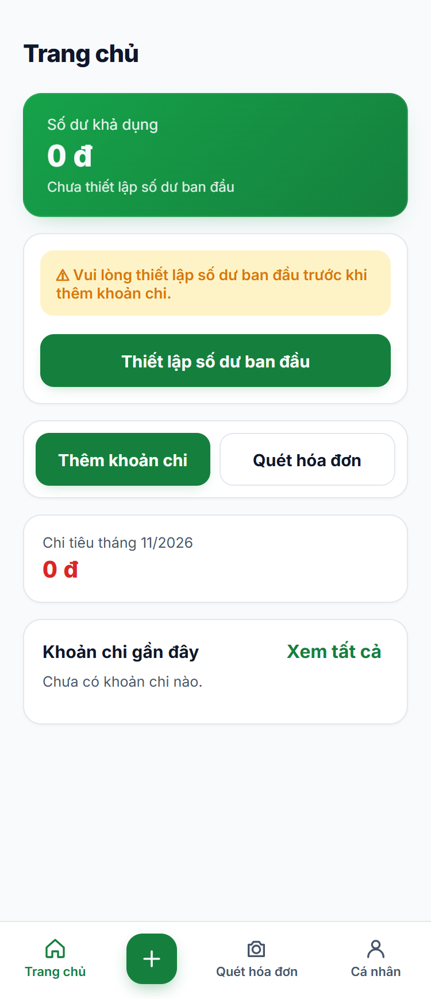
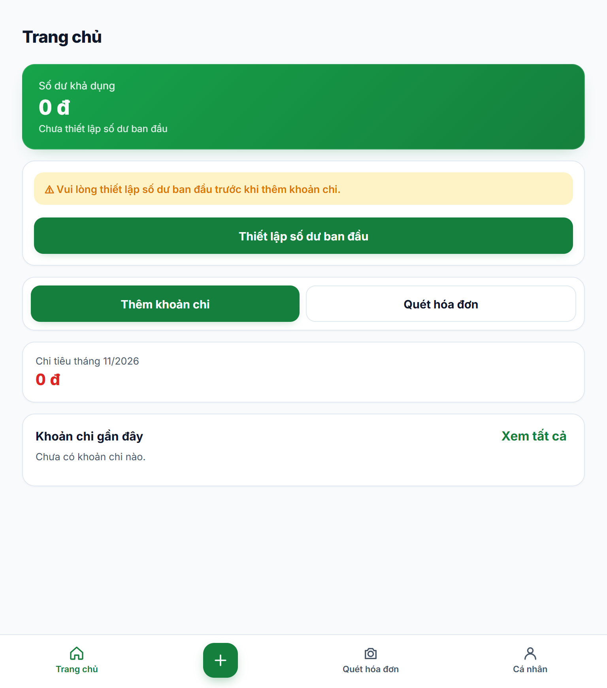
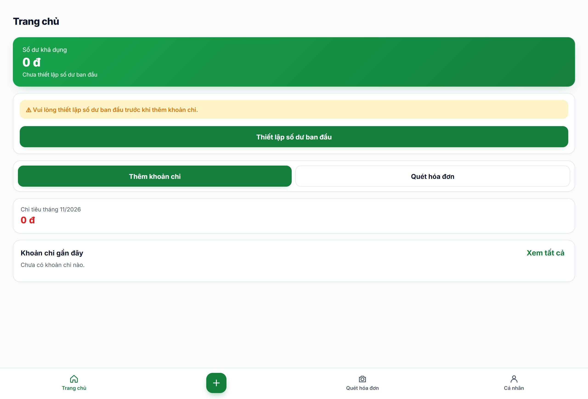

# Báo cáo kiểm thử thủ công & Responsive

* **Người thực hiện:** Phạm Minh Phúc (MSSV: 24090011)
* **Môi trường kiểm thử:** Google Chrome (`https://quan-ly-chi-tieu-sooty.vercel.app`)

## 1. Bảng kiểm thử chức năng và giao diện

| Mã test | Màn hình / Chức năng | Thao tác thực hiện | Kết quả mong đợi | Kết quả thực tế |
| :--- | :--- | :--- | :--- | :--- |
| TC-01 | Form nhập / Đăng ký & Thêm khoản chi | Bỏ trống các trường bắt buộc hoặc nhập số tiền âm/sai định dạng rồi bấm gửi | Báo lỗi rõ ràng trên trường lỗi, không gửi request sai | **Đạt** – Hiển thị thông báo lỗi ngay dưới trường nhập và chặn gửi form |
| TC-02 | Modal (Hộp thoại điều khoản / thiết lập số dư / chi tiết) | Bấm mở Modal (xem Điều khoản hoặc Thiết lập số dư) và bấm nút Đóng (X) / Hủy | Modal hiển thị đầy đủ nội dung tương ứng và đóng mượt mà khi bấm Đóng/Hủy, không làm thay đổi dữ liệu hiện tại | **Đạt** – Modal mở đúng nội dung, thao tác đóng mượt và giữ nguyên trạng thái dữ liệu khi hủy |
| TC-03 | Quét hóa đơn AI tạo bản nháp | Tải lên ảnh chụp hóa đơn tại màn hình Quét hóa đơn AI và xác nhận lưu | Hệ thống trích xuất thông tin tạo bản nháp cho phép kiểm tra trước khi lưu chính thức | **Đạt** – Tạo bản nháp điền sẵn số tiền, ngày, nội dung chính xác và lưu thành công vào lịch sử |
| TC-04 | Danh sách / Bộ lọc dữ liệu lịch sử | Nhập từ khóa tìm kiếm, chọn bộ lọc theo loại, danh mục hoặc khoảng thời gian | Danh sách cập nhật đúng theo điều kiện lọc | **Đạt** – Lọc và trả về chính xác các bản ghi khớp điều kiện |
| TC-05 | Trạng thái rỗng & lỗi mạng | Lọc ra 0 bản ghi hoặc mất kết nối tới server | Hiển thị trạng thái rỗng hoặc thông báo lỗi dễ hiểu, không trắng trang | **Đạt** – Hiển thị thông báo không tìm thấy dữ liệu / cảnh báo kết nối rõ ràng |
| TC-06 | Mobile (`375px`) & Tablet (`768px`) | Mở trang ở chiều rộng `375px` và `768px` | Bố cục xếp gọn, không vỡ giao diện, không bị cuộn ngang | **Đạt** – Các thẻ và thanh điều hướng co giãn hợp lý, không tràn ngang |
| TC-07 | Desktop (`1280px`) | Mở trang ở chiều rộng `1280px` | Bố cục cân đối, thao tác mượt mà | **Đạt** – Giao diện hiển thị cân đối, đầy đủ cột và thao tác phản hồi nhanh |

## 2. Bằng chứng kích thước màn hình (Responsive)

- **Mobile (`375px`):** Giao diện thu gọn 1 cột, menu và các thẻ thống kê hiển thị vừa khít khung nhìn, không xuất hiện thanh cuộn ngang.
  
- **Tablet (`768px`):** Bố cục tự động căn chỉnh lưới 2 cột cân đối, các nút chức năng và bộ lọc dễ thao tác.
  
- **Desktop (`1280px`):** Hiển thị đầy đủ không gian làm việc, bảng danh sách và khu vực thao tác trực quan, rõ nét.
  